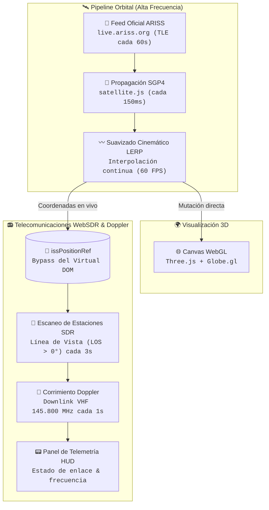

# ARISS Tracker

> Aplicación web en tiempo real para el rastreo de la Estación Espacial Internacional (ISS), cálculo de la mejor estación terrestre (ARISS / WebSDR) con la que contactar y cálculo dinámico del efecto Doppler con visualización en 3d del globo terráqueo.

[](https://react.dev/)
[](https://www.typescriptlang.org/)
[](https://threejs.org/)
[](https://vitejs.dev/)
[](https://firebase.google.com/)

[🌐 Demo en Vivo](https://ariss-tracker.maxigimenez.com.ar/)

---

## Características Principales

* ** Visualización 3D a 60 FPS:** Renderizado interactivo del globo terráqueo con Three.js y Globe.gl, proyección de la órbita terrestre y suavizado cinemático continuo.
* ** Propagación Orbital SGP4 en Vivo:** Descarga periódica de Two-Line Elements (TLE) oficiales desde ARISS (`live.ariss.org`), transformando coordenadas inerciales ECI a geodésicas en tiempo real.
* ** Selección Inteligente de Estaciones WebSDR:** Evaluación topocéntrica continua sobre una red global de estaciones terrestres para enlazar con la de mayor elevación sobre el horizonte local (Línea de Vista / LOS $> 0^\circ$).
* ** Simulación de Efecto Doppler:** Cálculo numérico instantáneo de la velocidad radial respecto a la estación activa para corregir la frecuencia nominal de downlink (145.800 MHz VHF).
* ** Alto Rendimiento sin Sobrecarga:** Actualización de posición a 150 ms mediante mutación directa a WebGL y DOM con `useRef`, evitando re-renders innecesarios en el ciclo de React.
* ** Internacionalización Nativa:** Sistema de i18n tipado en tiempo de compilación con soporte completo para Español (`es`), Inglés (`en`) y Portugués (`pt`).
* ** Arquitectura Dual Layout:** 
  * `/tracker`: Cabina de visualización HUD a pantalla completa con simulación de terminal de arranque (*Boot Sequence*).
  * `/`: Vista documental y explicativa con los fundamentos físicos, matemáticos y de radiofrecuencia.

---

## Flujo de Datos



---

## Puesta en Marcha

### Requisitos Previos
* **Node.js:** Versión 18+ (recomendado v20 LTS o superior)
* **Gestor de paquetes:** `npm`, `pnpm` o `yarn`

### Instalación y Ejecución

```bash
# 1. Clonar el repositorio
git clone https://github.com/MaximilianoGimenez0/ARISS-tracker.git
cd ARISS-tracker

# 2. Instalar dependencias
npm install

# 3. Iniciar el entorno de desarrollo
npm run dev
```

La aplicación quedará disponible en `http://localhost:5173`.

> **Nota:** No se requieren variables de entorno (`.env`) ni API keys privadas para el funcionamiento local. La aplicación consume el feed público oficial de ARISS de forma directa.

### Scripts Disponibles

```bash
npm run dev      # Inicia el servidor de desarrollo con Vite
npm run lint     # Ejecuta el análisis estático ultra rápido con Oxlint
npm run build    # Verifica tipos con TypeScript y compila el bundle de producción
npm run preview  # Previsualiza localmente la compilación de dist/
```

---

## Stack Tecnológico

* **Frontend & UI:** React 19, TypeScript ~6.0, React Router DOM v7, React Icons.
* **Motor 3D & Física:** Three.js, Globe.gl, `satellite.js` (SGP4/SDP4).
* **Estilizado:** CSS Modules + Tokens globales en CSS.
* **Tooling:** Vite 8, Oxlint.
* **Hosting:** Firebase Hosting.

---

## Autor & Contacto

* **Maximiliano Giménez**
* **Portfolio:** [maxigimenez.com.ar](https://maxigimenez.com.ar)
* **GitHub:** [@MaximilianoGimenez0](https://github.com/MaximilianoGimenez0)
* **LinkedIn:** [Maximiliano Giménez](https://www.linkedin.com/in/maximiliano-gim%C3%A9nez-2644b0338/)
